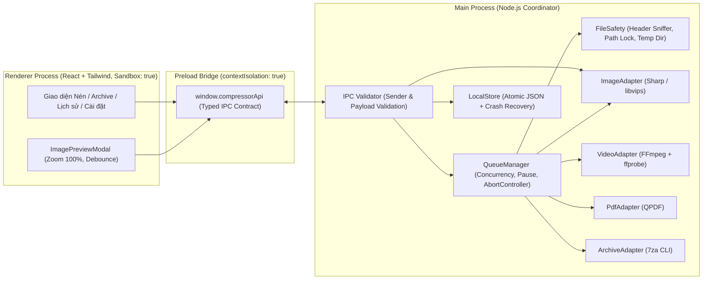

# Kiến trúc Hệ thống — File Compressor (`docs/ARCHITECTURE.md`)

## 1. Sơ đồ Phân tách Process (Electron Security & Isolation)

## 2. Các Quyết định Kỹ thuật Chính

### 2.1. Bảo mật Electron & IPC
- `BrowserWindow` chạy với `nodeIntegration: false`, `contextIsolation: true`, `sandbox: true`, `webSecurity: true`, khóa điều hướng (`will-navigate`) và chặn mở cửa sổ mới (`setWindowOpenHandler`).
- `Content-Security-Policy` nghiêm ngặt chỉ cho phép tài nguyên cục bộ (`'self'`, `data:`, `blob:`).
- Mọi handler IPC trong `src/main/index.ts` đều kiểm tra `validateIpcSender(event)` và làm sạch dữ liệu cấu hình qua `sanitizeJobConfig()`.
- Mọi tiến trình dòng lệnh (`ffmpeg.exe`, `ffprobe.exe`, `qpdf.exe`, `7za.exe`) đều được gọi qua `spawn(exePath, args, { shell: false, windowsHide: true })` từ đường dẫn tuyệt đối cố định; tuyệt đối không ghép chuỗi lệnh shell từ tên file của người dùng.

### 2.2. Quản lý Hàng đợi, Concurrency & Hủy Cây Tiến trình (Process Tree Termination)
- `QueueManager` duy trì giới hạn xử lý song song riêng theo từng nhóm tác vụ (mặc định: 3 Ảnh, 1 Video, 2 PDF, 1 Archive) để không làm nghẽn CPU hay tràn RAM khi người dùng thả hàng trăm file hỗn hợp.
- Không đọc toàn bộ video hay file lớn vào bộ nhớ JavaScript; stdout/stderr của các tiến trình con được đọc dạng luồng theo từng dòng và giới hạn trong ring buffer tối đa 150 dòng cuối để tránh deadlock pipe và rò rỉ bộ nhớ.
- Khi người dùng nhấn **Hủy**, `AbortController` kích hoạt `killProcessTree()` gọi `taskkill.exe /PID <pid> /T /F` trên Windows, chờ tiến trình thực sự kết thúc rồi mới dọn dẹp thư mục tạm `.fc_tmp_<jobId>`.

### 2.3. Lưu trữ Bền vững (LocalStore) & Phục hồi sau sự cố (Crash Recovery)
- Chọn **Atomic JSON Store** (`<userData>/file-compressor-state-v1.json`) với chuỗi ghi tuần tự (`writeChain`): mỗi lần lưu đều ghi ra file tạm `<store>.<pid>.tmp` rồi đổi tên nguyên tử (`fs.promises.rename`) đè lên file chính.
- Lý do chọn Atomic JSON thay vì SQLite native: tránh thêm một dependency C++ native thứ hai cần biên dịch theo ABI Electron bên cạnh `sharp`, trong khi dữ liệu cấu hình, hàng đợi và lịch sử (giới hạn 300 mục) có kích thước nhỏ (< 500 KB), đọc/ghi nguyên tử cực nhanh và dễ kiểm chứng.
- Khi khởi động lại ứng dụng sau khi mất điện hoặc crash, `LocalStore.loadAndMigrate()` tự động phát hiện mọi tác vụ đang dở ở trạng thái `running` / `probing` / `validating` từ phiên trước và chuyển sang trạng thái `interrupted`, cho phép người dùng nhấn **Thử lại** để chạy lại sạch từ đầu.

### 2.4. An toàn File & Chống Xung đột Tên Đầu ra
- Hàm `areSameFilePaths()` sử dụng `fs.realpathSync.native()` chuẩn hóa chữ thường trên Windows để chặn mọi trường hợp nguồn và đích trỏ cùng một file vật lý.
- Hàm `allocateUniqueOutputPath()` kết hợp kiểm tra trên đĩa (`fs.existsSync`) với tập hợp khóa trong bộ nhớ (`reservedOutputPaths`) để đảm bảo nhiều tác vụ kết thúc cùng một mili-giây không bao giờ ghi đè lên nhau hoặc ghi đè file có sẵn.

